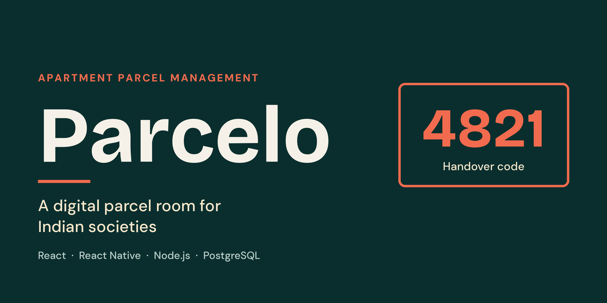

# 📦 Parcelo
**A digital parcel room for Indian apartment societies.**

Guards log every parcel at the gate, residents choose when and how to receive it, and a one-time code closes each handover with a permanent record.


---

## Table of contents
- [The problem](#the-problem)
- [Features](#features)
- [How it works](#how-it-works)
- [Tech stack](#tech-stack)
- [Architecture](#architecture)
- [Project structure](#project-structure)
- [Getting started](#getting-started)
- [Environment variables](#environment-variables)
- [API overview](#api-overview)
- [Data model](#data-model)
- [Security](#security)
- [Roadmap](#roadmap)
- [Screenshots](#screenshots)
- [Contributing](#contributing)
- [License](#license)
- [Author](#author)

## The problem
In most Indian apartment societies, parcels are handled informally at the gate:

- Parcels pile up in the guard room with no log of what arrived or when.
- Working residents miss deliveries, and failed attempts end in returns.
- There is no proof of who collected a parcel, so disputes have no answer.

Society apps such as MyGate and NoBrokerHood mainly handle visitors and gate approvals. Parcelo adds the missing parcel layer.
## Features
- **Parcel logging**: the guard records flat, courier and a photo in a few taps.
- **Mobile app**: residents and guards use the [Parcelo mobile app](https://github.com/KingSalvatore7000/parcelo-mobile); admins use the website.
- **Parcel alerts**: new-parcel messages and reminders go through a pluggable channel. It prints them to the server log by default; WhatsApp and SMS are optional and need provider keys. Push notifications are planned.
- **Slot scheduling**: the resident picks pickup from the parcel room (free) or door delivery (paid), and a time slot.
- **Code-verified handover**: a 4-digit one-time code is shown to the resident and entered by the guard to complete the handover.
- **Admin dashboard**: live counts, overdue-parcel list, reminders, and resident and flat management.
- **Live updates**: new parcels and status changes appear instantly on the guard desk through WebSockets.

## How it works
1. **Log**: a parcel arrives and the guard logs it against a flat.
2. **Notify**: an alert is queued for everyone linked to that flat, and the parcel appears in their app.
3. **Schedule**: the resident chooses pickup or door delivery and a slot, and receives a 4-digit code.
4. **Hand over**: the guard enters the code, the parcel is marked handed over, and the guard ID and timestamp are saved.
5. **Follow up**: a daily job reminds residents about parcels waiting more than 2 days and flags old ones to the admin.

## Tech stack
| Layer | Technology |
|---|---|
| Web (admin dashboard, guard desk) | React, Vite, Tailwind CSS |
| Mobile (residents and guards, separate repo) | React Native (Expo) |
| Backend | Node.js, Express, TypeScript, Zod |
| Realtime | Socket.io |
| Database | PostgreSQL with Prisma |
| Notifications | Outbox with console, WhatsApp Cloud API or MSG91 SMS providers |
| Auth | Mobile number and password (bcrypt), JWT with refresh tokens |
| Storage | Local disk with signed links for parcel photos (object storage planned) |

## Architecture

```
Mobile app (React Native)    ─┐
Guard desk (React)           ─┼─►  Node.js + Express API  ─┬─► PostgreSQL (Prisma)
Admin dashboard (React)      ─┘    REST · Socket.io · JWT  ├─► Console / WhatsApp / SMS
                                                           └─► Photo storage
```

## Project structure

```
parcelo/
├── apps/
│   ├── api/        # Express API, Prisma schema, jobs
│   └── web/        # Admin dashboard, guard desk and intro page (React)
├── packages/
│   └── shared/     # Shared types and Zod schemas
├── docker-compose.yml
└── README.md
```

## Getting started

### Prerequisites
- Node.js 20 or later
- Docker Desktop (for local PostgreSQL, exposed on host port **5433**)

### Setup
```bash
# 1. Clone
git clone https://github.com/KingSalvatore7000/parcelo.git
cd parcelo

# 2. Install dependencies
#    (postinstall builds packages/shared and generates the Prisma client)
npm install

# 3. Start PostgreSQL
npm run db:up

# 4. Configure environment
#    The API reads the root .env; the Prisma CLI reads apps/api/.env
cp .env.example .env
cp .env.example apps/api/.env

# 5. Create tables
npm run db:migrate

# 6. Load demo data (safe to re-run: creates or updates the demo society, flats and users)
npm run db:seed

# 7. Run the apps (separate terminals)
npm run dev:api   # http://localhost:4000
npm run dev:web   # http://localhost:5173
```

Other scripts: `npm run build` (shared, API and web), `npm test` (API tests), `npm run db:studio`, `npm run db:down`.

### Tests
`npm test` runs the API suite (Vitest + Supertest) against a separate `test` schema in the same Postgres, rebuilt from the migrations on every run, so your dev data is never touched. Set `TEST_DATABASE_URL` to use another database. GitHub Actions runs the same suite, the API type-check and the web build on every push and pull request (`.github/workflows/ci.yml`).

### Deploy with Docker
```bash
cp .env.example .env.prod   # set POSTGRES_PASSWORD, JWT_SECRET, PUBLIC_WEB_URL, PUBLIC_API_URL and the message provider
docker compose -f docker-compose.prod.yml --env-file .env.prod up -d --build
```
The API container applies pending migrations on start. Put a TLS proxy in front of the web (8080) and API (4000) ports, and do not leave those ports open to the internet directly. Set `TRUST_PROXY` to the number of proxies in front of the API (the compose file defaults to `1`), or rate limits will treat all visitors as one.

Never run `npm run db:seed` on a production database. It creates accounts with a public password, so it refuses when `NODE_ENV=production`.

Before a real launch: send `{"event":"security_alert"}` log lines to an alert on your host, and if the host's disk is not persistent, mount a volume for `apps/api/uploads` or parcel photos will be lost on restart.

> The mobile app for residents and guards is in its own repository: [parcelo-mobile](https://github.com/KingSalvatore7000/parcelo-mobile).

### Demo flow
The seeded demo accounts (`npm run db:seed`) all use the password `Demo@1234`: guard `9876543210`, admin `9876543211`, residents `9876543212` and `9876543213`. On the dev server the login page also has one-click demo profiles.

1. Sign in as the guard and log a parcel for a flat.
2. Sign in as that flat's resident and choose a slot. A 4-digit code appears.
3. Back on the guard desk, enter a wrong code to see the error, then the right code to complete the handover.
4. Open the admin dashboard to see the counts update.

## Environment variables

Used today (see `.env.example`):

| Variable | Description |
|---|---|
| `PORT` | API port (default `4000`) |
| `NODE_ENV` | `development`, `test` or `production`. **Unset means production.** |
| `DATABASE_URL` | PostgreSQL connection string (required in production) |
| `JWT_SECRET` | Secret for signing access tokens and photo links (production: random, 32+ characters) |
| `JWT_EXPIRES_IN` | Access token lifetime (default `15m`); the app renews it with the refresh token |
| `REFRESH_TOKEN_DAYS` | How long a device stays signed in without use (default `30`) |
| `CORS_ORIGIN` | Comma-separated allowed web origins, never `*` (default: `https://parceloo.onrender.com`, plus localhost outside production) |
| `TRUST_PROXY` | Proxy hops in front of the API, for correct client IPs (default `0`) |
| `DOOR_DELIVERY_FEE_PAISE` | Door delivery fee in paise (default `2000` = ₹20) |
| `NOTIFY_CHANNEL` | Parcel alerts and reminders: `console` (prints them), `whatsapp` or `sms` |
| `WHATSAPP_*` | WhatsApp Cloud API token, phone number id, language and template names |
| `MSG91_*` | MSG91 auth key and DLT template ids |
| `JOBS_ENABLED` | Background jobs (default on, off in tests) |
| `REMINDER_AFTER_DAYS` | Remind residents after this many days (default `2`, daytime IST, once a day) |
| `UNCLAIMED_AFTER_DAYS` | Mark parcels unclaimed after this many days (default `7`) |
| `PHOTO_URL_TTL_MINUTES` | How long a parcel photo link works (default `60`) |
| `VITE_API_URL` | (web) API base URL, default `http://localhost:4000` |
| `VITE_DEMO_MODE` | (web) `true` shows demo logins in a production build |

In production the API refuses to start if `DATABASE_URL` or a real `JWT_SECRET` is missing. It also refuses `CORS_ORIGIN=*` in any environment.

### Messages
Sign-in does not use WhatsApp or SMS. With the default `NOTIFY_CHANNEL=console`, parcel alerts are only printed in the server log, so residents see new parcels by opening the app.

New-parcel alerts and reminders are written to an outbox table and sent every 30 seconds through `NOTIFY_CHANNEL`, retried up to 3 times. Register these templates with your provider (variables in this order): **NEW_PARCEL** (courier, flat), **REMINDER** (courier, flat, days waiting), and put their names or ids in the matching `WHATSAPP_TEMPLATE_*` or `MSG91_TEMPLATE_*` variables.

## API overview

| Method | Route | Purpose |
|---|---|---|
| POST | `/auth/login` | Mobile number and password; returns an access and a refresh token |
| POST | `/auth/password` | Change your password (required after a temporary one) |
| POST | `/admin/users/:id/reset-password` | Admin: a new one-time temporary password for someone who forgot theirs |
| POST | `/auth/refresh` | Swap the refresh token for a new pair (the old one stops working) |
| POST | `/auth/logout` | End this device's session |
| POST | `/parcels` | Guard logs a parcel |
| GET | `/parcels` | List parcels, scoped by role |
| GET | `/parcels/slots` | Bookable slots (IST, today and tomorrow) and fees |
| POST | `/parcels/upload-photo` | Guard uploads a parcel photo (JPEG, PNG or WebP, up to 5 MB) |
| GET | `/flats` | Guards and admins: the society's flats |
| POST | `/parcels/:id/schedule` | Resident chooses mode and slot, receives code (again to reschedule: new code, old one stops working) |
| POST | `/parcels/:id/handover` | Guard submits the code to complete handover (locks after 5 wrong tries) |
| POST | `/parcels/:id/return` | Guard returns an uncollected parcel to the courier |
| GET | `/admin/stats` | Dashboard counts, overdue parcels, door-delivery fees this month |
| GET/POST/PATCH/DELETE | `/admin/flats`, `/admin/users` | Manage flats and people (admins cannot remove or demote themselves) |
| POST | `/admin/residents/import` | CSV import `name,phone,tower,flat`, all-or-nothing, `dryRun` to check first |

## Data model
`Society` · `Flat` · `User` · `Parcel` · `Handover` · `Notification` · `RefreshToken`

Parcel status flow: `LOGGED → SCHEDULED → HANDED_OVER` (with `UNCLAIMED` and `RETURNED` as side states).

## Security
- Password sign-in (bcrypt) with limits on wrong attempts, short-lived tokens and rotating refresh tokens; admins issue one-time temporary passwords that must be changed at first sign-in
- Handover codes stored **hashed**, with expiry and attempt limits
- Every query scoped to a single society, with role-based access on every route
- Private photo storage and minimal personal data, following the principles of India's DPDP Act
- Sign-out, password changes and admin resets end the affected sessions at once, including live connections
- Per-number, per-IP and per-user rate limits on sign-in and expensive actions
- Uploads checked by content and size, stored under random names, served only on signed links
- CSP and other security headers, HTTP to HTTPS redirects, and no cached API answers
- Security events (failed sign-ins, denied requests, admin actions) logged as JSON without passwords or tokens, with a `security_alert` line on spikes

## Roadmap
- [x] Parcel logging and code-verified handover
- [x] Resident slot scheduling
- [x] Admin dashboard
- [x] Mobile app for residents and guards
- [x] Security review before launch
- [ ] Deploy to production
- [ ] Pilot in one or two societies
- [ ] Push notifications
- [ ] Payments for door delivery (Razorpay)
- [ ] Smart parcel lockers
- [ ] Integration with existing society apps and courier tracking

## Screenshots
_Add screenshots here._

| Resident app | Guard desk | Admin dashboard |
|---|---|---|
|  |  |  |

## Contributing
Contributions are welcome.

1. Fork the repository
2. Create a branch: `git checkout -b feature/your-feature`
3. Commit your changes: `git commit -m "Add your feature"`
4. Push the branch and open a pull request


## Author
**Amarnath** · B.E. Computer Science and Engineering, Kumaraguru College of Technology, Coimbatore
GitHub: [@KingSalvatore7000](https://github.com/KingSalvatore7000)

